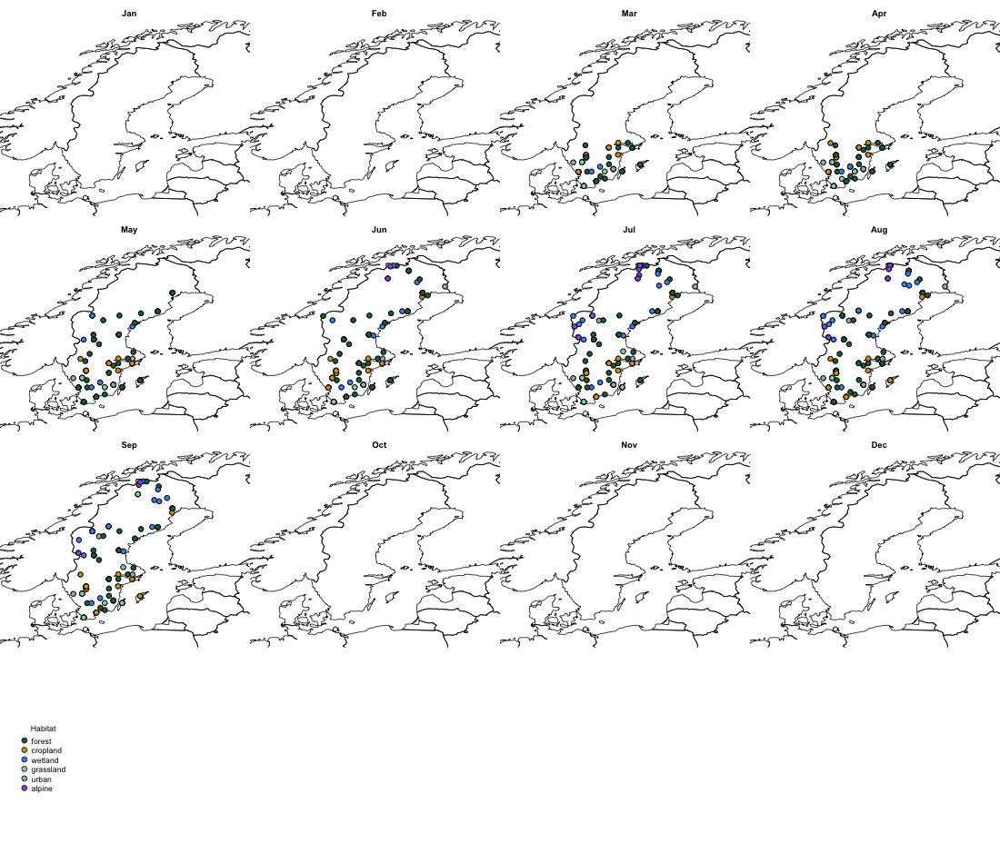
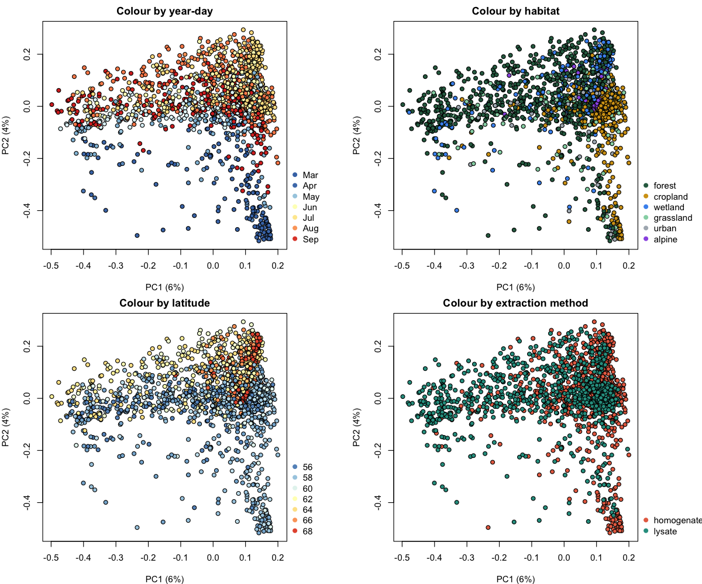
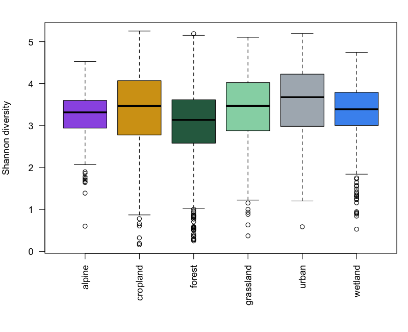
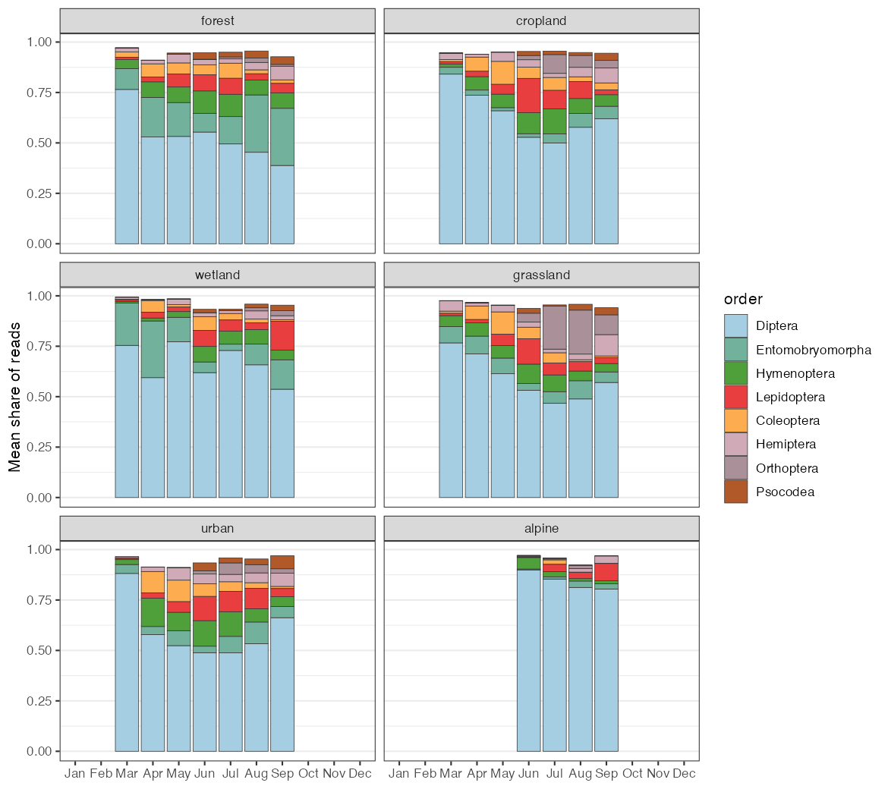
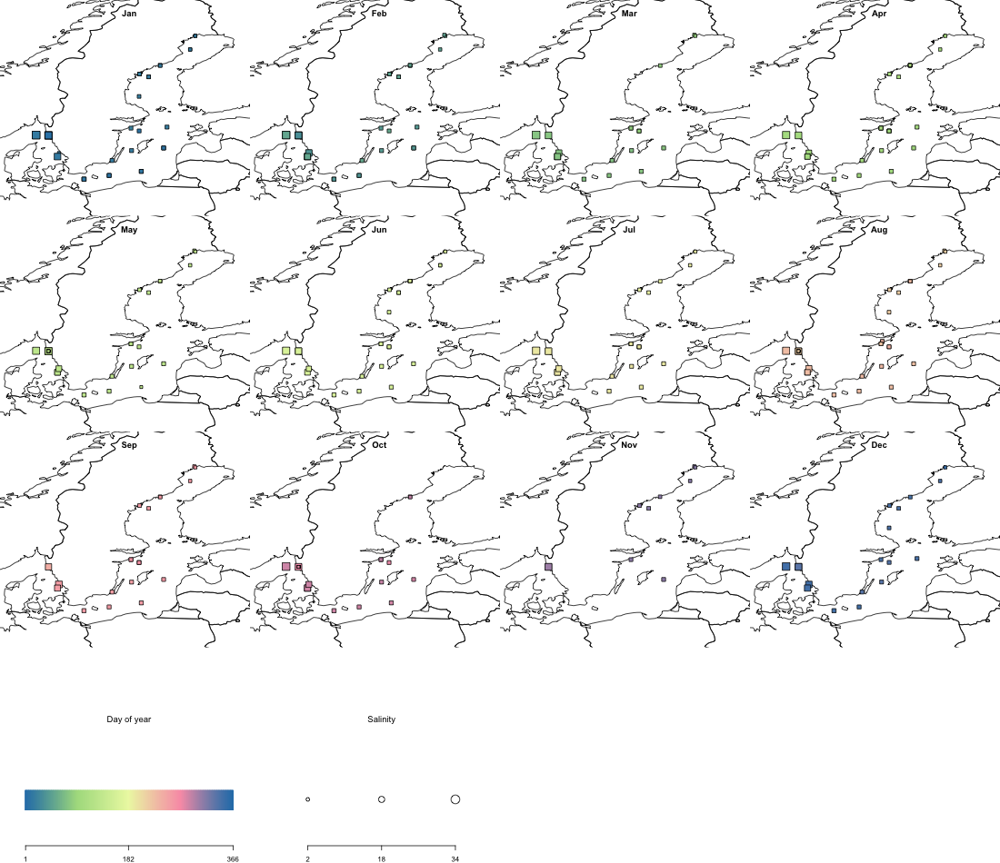
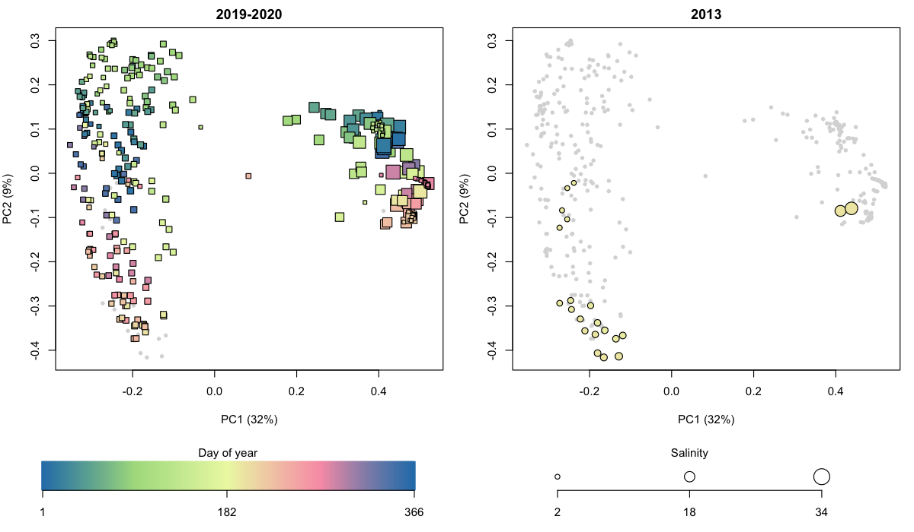
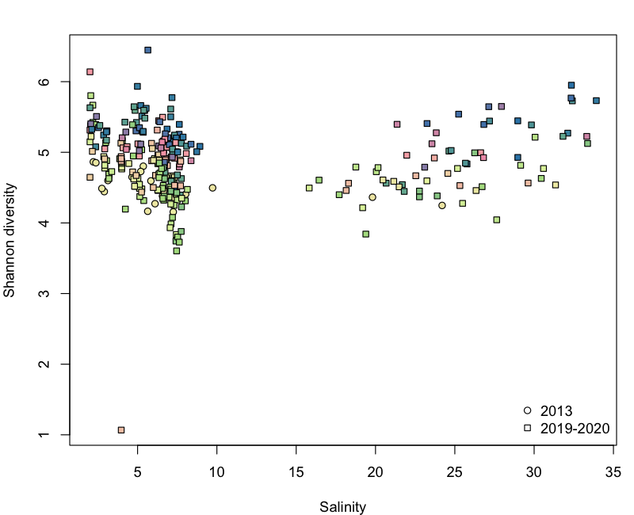
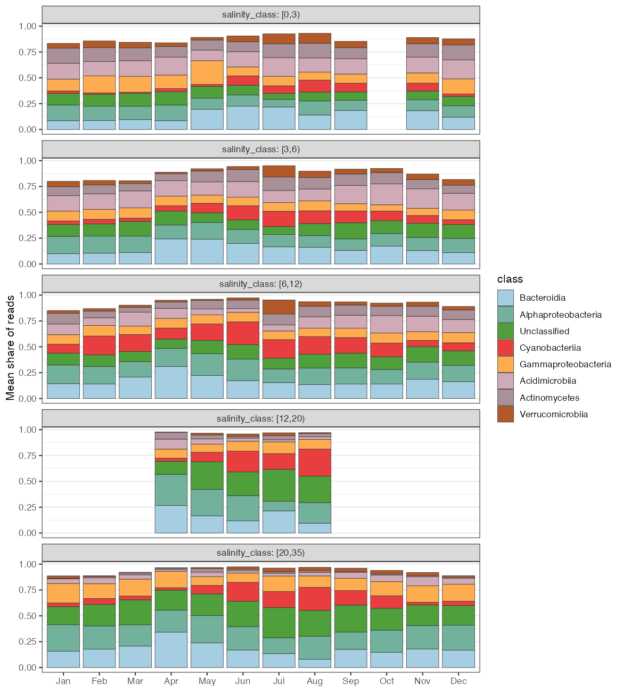

*Example results from running the two tracks of the tutorial on data downloaded from the ASV portal in November 2026.*

## Insects

*Two IBA COI datasets, `IBA_CO1_homogenate_2019_SE` and `IBA_CO1_lysate_2019_SE`, after the republication of the IBA datasets in October 2026.*

### Sampling sites across Sweden

*One map per month of the paired sampling sites (814 per extraction method), coloured by habitat type.*

### Community differences — beta diversity (PCoA)

*Principal Coordinates Analysis (Bray-Curtis dissimilarity) of cluster-level community composition of the paired samples, coloured by year-day, habitat, latitude and extraction method. In a PERMANOVA with all four variables, habitat explains about 3.7% of the variation, sampling date 2.2%, latitude 1.7% and extraction method 1.5%, while about 90% remains unexplained. The test does not take the pairing of the samples into account, so it is descriptive.*

### Within-sample diversity (alpha diversity) — Shannon index

*Diversity within each of the 4,380 lysate samples, by habitat.*

### Taxonomic composition by habitat

*Mean monthly share of reads of the most common insect orders in each habitat type.*

## Marine plankton

*Two Baltic Sea 16S datasets, `KTH-2013-Baltic-16S` (21 samples) and `PRJEB55296-16S` (331 samples).*

### Sampling sites across the Baltic Sea

*One map per month of the 2019–2020 samples, coloured by day of year and sized by salinity.*

### Community differences — beta diversity (PCoA)

*Principal Coordinates Analysis (Bray-Curtis dissimilarity) of ASV-level community composition. The first axis holds about a third of the variation and follows salinity closely (correlation 0.96).*

### Within-sample diversity (alpha diversity) — Shannon index

*Diversity within each sample against salinity.*

### Taxonomic composition by salinity

*Mean monthly share of reads of the most common bacterial classes in five salinity intervals.*

